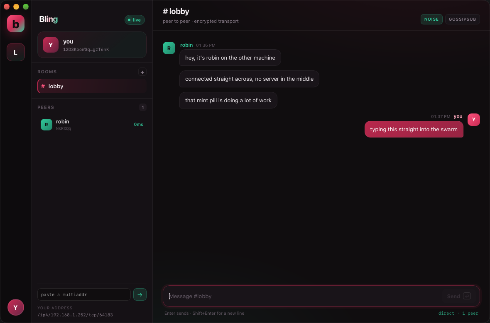

# Bling

A peer-to-peer chat app. Rose `#D1305E` and mint `#30D1A3` on near-black.

Messages travel machine to machine over libp2p. There is no server, no account,
no message store in the middle.



## Download

Grab the latest build from [Releases](https://github.com/occiderunt/bling/releases).

- **macOS** (Apple silicon): open the `.dmg`, drag Bling to Applications. The
  build is ad-hoc signed, so on first launch use right-click → Open, or run
  `xattr -dr com.apple.quarantine /Applications/Bling.app`.
- **Windows**: run the `-setup.exe`.
- **Android** (arm64): install the APK from Releases. It is signed with the
  Bling release key, so it updates in place over earlier versions.
  Or if you have F-Droid installed, click this:

  [](https://fdroid.link/#https://occiderunt.github.io/f-droid/repo?fingerprint=64368073B62C6B3086D30B92961CD393AA2B960E1E682CD7F3BECACB9D7D9956)


Desktop builds are produced by GitHub Actions from the tag, every release. The
Android release build is signed locally with the project's release key and
attached to the release; CI does not sign Android builds, so you can reproduce
an unsigned APK with the steps below.

An F-Droid repo also carries Bling:
`https://occiderunt.github.io/f-droid/repo` (add it in F-Droid → Settings →
Repositories). Its APK is the same signed build as the one in Releases.

## Stack

- Tauri 2 shell with a plain HTML/CSS/JS webview (no bundler).
- Rust backend (`src-tauri/src/net.rs`) owns the swarm. The webview never makes
  a network call; it talks to Rust over Tauri commands and one event channel.
- libp2p 0.57:
  - gossipsub, one topic per room: `bling/room/<name>`
  - noise + yamux over TCP, plus QUIC
  - identify, ping, mDNS for local discovery
  - ed25519 identity persisted in the app data dir, so your peer id is stable
  - paired peers saved to `peers.json`, so a restart redials them on its own

## Build it yourself

Desktop:

```bash
npm install
npm run tauri build -- --bundles app   # or dmg / nsis
```

Android needs the SDK and NDK plus a JDK, then:

```bash
npm install
npx tauri android init     # only if src-tauri/gen/android is missing
npx tauri android build --apk --target aarch64
```

The Android project lives in `src-tauri/gen/android` and is committed, because
it carries the hand edits Tauri does not regenerate:

- `AndroidManifest.xml` declares `POST_NOTIFICATIONS` and
  `ACCESS_LOCAL_NETWORK`. Android 17 (API 37) blocks LAN traffic by default, so
  `MainActivity` requests that permission at runtime; without it libp2p dials
  and mDNS silently fail with "failed to negotiate transport protocols".
- The launcher icon, adaptive icon background, and the `compileSdk`/`targetSdk`
  37 targets with `minSdk 24`.
- `app/build.gradle.kts` reads release signing from `keystore.properties` or
  `BLING_KEYSTORE` / `BLING_KEYSTORE_PASSWORD` / `BLING_KEY_ALIAS` env vars.
  Copy `src-tauri/gen/android/keystore.properties.example` to sign. With no
  keystore configured, the release APK is simply unsigned: use
  `apksigner sign --ks <keystore> app-universal-release-unsigned.apk`.

Desktop and Android share the same Rust backend. The mobile entry point is
`#[cfg_attr(mobile, tauri::mobile_entry_point)] pub fn run()` in
`src-tauri/src/lib.rs`; `main.rs` calls it.

Dev binaries:

```bash
cd src-tauri
cargo run --bin bling           # the app
cargo run --bin twonode         # two nodes in one process, asserts delivery
cargo run --bin bot -- --listen # a throwaway peer that chats after you dial it
```

The app listens on TCP and QUIC and shows its dialable address in the sidebar.
Ways to connect:

1. **mDNS**: peers on the same network appear by themselves. On macOS the app
   needs Local Network permission for this.
2. **Invite**: press **invite** in the header. It shows a QR code and a
   `bling://join?room=…&addr=…` link. The other device scans the code (Android)
   or opens the link, and lands in the room, already dialled. Sending the link
   in any chat app works too: it is a registered URL scheme on desktop and
   Android.
3. **Paste a multiaddr**: copy `/ip4/<ip>/tcp/<port>/p2p/<peer-id>` from one
   instance into the other's sidebar. This always works, including over
   loopback. The app asks for port 4101 both times, so the address survives a
   restart.

Rooms live in the sidebar: `+` creates one, hovering a room reveals `×` to
leave it, and **invite** in the header copies a `bling://join?room=…&addr=…` link
that connects and opens the room when pasted into the same box.

Peers announce their nickname the moment they connect, so names appear before
anyone speaks. If a peer drops, the app retries every known address for it
(backoff up to 20s) and reconnects on its own.

`BLING_DATA=/tmp/whatever cargo run --bin bling` gives an instance its own
identity, and `BLING_DIAL=/ip4/.../p2p/...` auto-dials a peer at startup.

## Checks

```bash
node scripts/smoke.mjs   # 43 UI checks against a mocked bridge
node scripts/shot.mjs    # screenshots into shots/
cargo run --bin twonode  # networking checks on real sockets
```

## Known gaps

- No store-and-forward: if the other person is offline, the message is gone.
  A relay or mailbox node is the next real piece of work.
- Rooms are gossipsub topics, so anyone who knows the name can join. No invite
  or capability model yet.
- History lives in the webview's localStorage per device, capped at 300
  messages per room.
- Transport is encrypted and signed by libp2p (noise + gossipsub strict
  validation), but payloads are plain JSON, not a sealed E2E format.
- Ping latency shows `0ms` over loopback; that is honest, not a bug.
- Android notifications only arrive while the app process is alive; real push
  with the app killed needs FCM, which does not fit a serverless app. There is
  no iOS build yet.

## License

MIT
